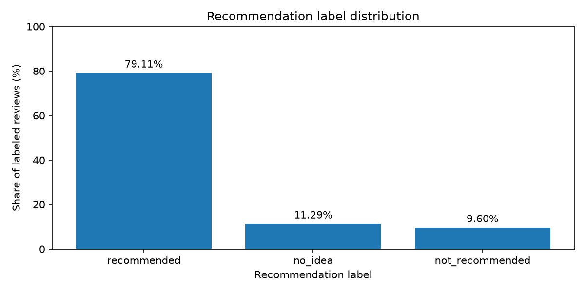
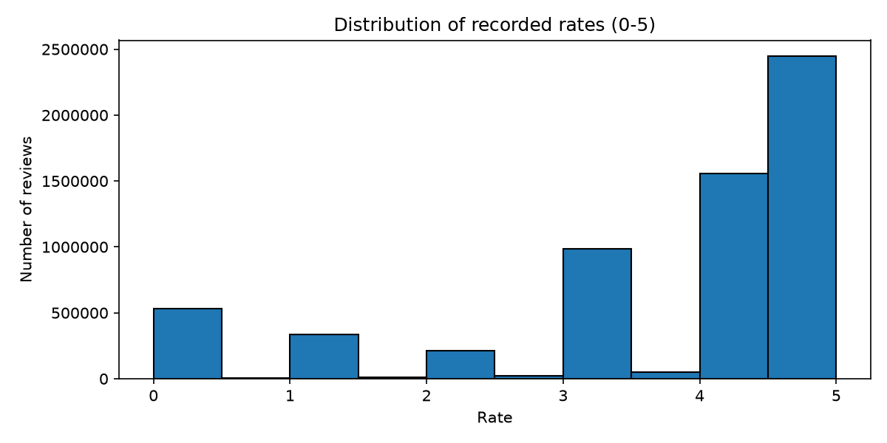
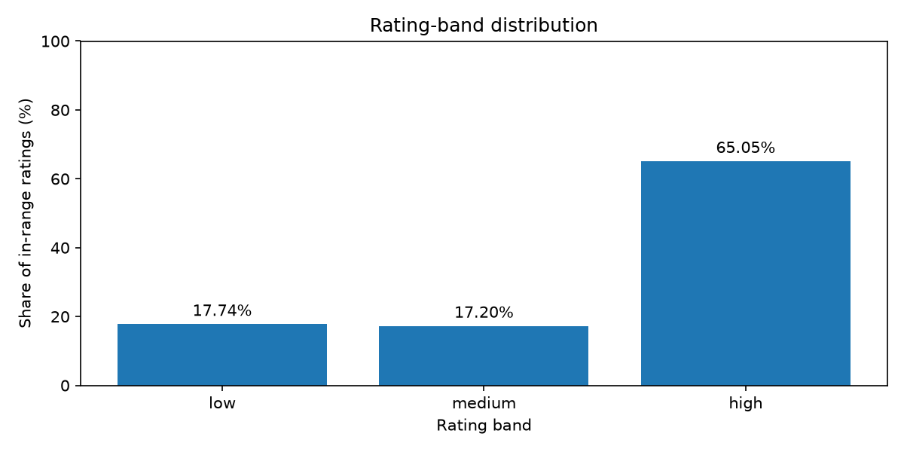

# Digikala Review Lab

Persian product-review analysis using **the review body alone**. The project will compare TF-IDF + Logistic Regression with a fine-tuned Transformer for two tasks: predicting product recommendation status and an ordered rating band. A controlled pseudo-labeling experiment will then test whether artificially unlabeled training reviews improve recommendation classification.

**Current status:** descriptive analysis is in progress. The complete comments CSV contains **6,156,289 reviews and 15 columns**. Row counts, missingness, recommendation distributions, numeric-rating checks and rating summaries have been computed over the full file. Modeling, product-grouped splits and offline prediction are upcoming; no trained-model or test score is available yet.

## What the project is designed to predict

| Target | Meaning | Classes |
|---|---|---|
| `recommendation_status` | Whether the reviewer recommends the product | `recommended`, `not_recommended`, `no_idea` |
| `rating_band` | An ordered band derived from the review's numeric `rate` | `low`, `medium`, `high` |

The only model feature is **`body`**. `title`, `rate`, recommendation labels, product and seller identifiers, timestamps, likes/dislikes, advantages and disadvantages are not model inputs. `rate` defines the rating-band target; `product_id` is reserved for grouped splitting. A missing recommendation label is different from the explicit `no_idea` class.

## Dataset and audit method

The public data comes from [RadeAI/Digikala_comments_products](https://huggingface.co/datasets/RadeAI/Digikala_comments_products/tree/89c3133b169c8d3793db8834f56f32fee33d9db0). The downloaded `digikala.rar` contains `digikala-comments.csv` and `digikala-products.csv`; the current analysis uses the comments file. The archive checksum and extracted-file sizes are recorded in [data_source.json](reports/data_source.json).

| Property | Observed value |
|---|---:|
| Reviews, counted with a CSV parser | 6,156,289 |
| Columns in the comments file | 15 |
| Comments CSV size | 1,278,526,959 bytes |
| Reviews with recommendation labels | 5,261,863 |
| Reviews with numeric rates in the inclusive 0-5 range | 6,156,288 |
| Non-numeric rate values | 0 |
| Reviews with out-of-range rates | 1 |

Global counts use `pandas.read_csv(..., chunksize=100_000)`, so the whole text dataset is not loaded into memory at once. Counting parser records also handles newlines inside quoted review text. The first-five-row preview is only an introductory example; it is not the source of the global statistics or charts. Aggregate rating summaries use each distinct rate's frequency as a weight rather than treating distinct values as equally frequent observations.

The current row count includes raw records before duplicate and model-input eligibility checks. The assignment's approximate seven-million-row description is not used as an observed count.

### Missing values

These counts use pandas' default CSV missing-value detection. Whitespace-only text, duplicate IDs and bodies, conflicting labels, and product/seller concentration still need their own audit.

| Column | Missing count | Missing percentage of all reviews |
|---|---:|---:|
| `body` | 637 | 0.01% |
| `recommendation_status` | 894,426 | 14.53% |
| `title` | 2,865,062 | 46.54% |
| `advantages` | 5,448,084 | 88.50% |
| `disadvantages` | 5,744,017 | 93.30% |
| `seller_title` | 302,181 | 4.91% |
| `seller_code` | 302,181 | 4.91% |
| `true_to_size_rate` | 6,065,516 | 98.53% |

The full 15-column table is in the [analysis notebook](notebooks/01_descriptive_analysis.ipynb) and [machine-readable summary](reports/descriptive_summary.json). Missing `body` means there is no review text available as model input. A missing recommendation label does not automatically invalidate an available rating-band target. The eventual data protocol must retain usable targets independently.

### Recommendation distribution

Denominator: **5,261,863 reviews with an observed recommendation label**, before checking text eligibility for modeling. Reviews without that label are excluded from this table.

| Recommendation | Reviews | Share of labeled reviews |
|---|---:|---:|
| `recommended` | 4,162,839 | 79.11% |
| `no_idea` | 594,121 | 11.29% |
| `not_recommended` | 504,903 | 9.60% |



The majority class represents 79.11% of these labeled reviews. Always predicting `recommended` would therefore give about 79% accuracy on this audit population while failing to identify either minority class. Macro F1 and per-class metrics will be needed alongside accuracy; this hypothetical rule is not a trained or held-out model result.

### Numeric-rating checks and descriptive statistics

Raw rate values are first read as strings with automatic NA conversion disabled, then converted in a separate audit table. Unparseable values are explicitly counted. The one out-of-range observation is **`2500.0`**. It is excluded from the current 0-5 numerical summaries and band counts without guessing a replacement value. The original CSV is unchanged; this does not by itself justify discarding any usable recommendation target from the same review.

| Statistic, over 6,156,288 in-range rates | Value |
|---|---:|
| Minimum | 0.0 |
| Maximum | 5.0 |
| Mean | 3.65 |
| Median | 4.0 |
| Population standard deviation, `ddof=0` | 1.5666 |
| Q1 / Q2 / Q3, linear interpolation | 3.0 / 4.0 / 5.0 |
| Fractional rates, nonzero fractional part | 228,128 (3.71%) |
| Zero rates | 529,098 (8.59%) |
| Nonzero integer-valued rates | 5,399,062 (87.70%) |



The histogram uses ten half-point bins and frequency weights; its last bin includes 5.0. `3.0` is counted as integer-valued despite its decimal representation. The meaning of zero in the source remains unresolved: zero is retained in the current summaries and falls in the assignment's `low` band, but this is not evidence that every zero was an intentionally selected rating.

### Rating-band distribution

The assignment fixes the boundaries and ordinal encoding (`low=0`, `medium=1`, `high=2`):

| Band | Rate boundary | Reviews | Share of in-range rates |
|---|---|---:|---:|
| `low` | `0 <= rate < 2.5` | 1,092,329 | 17.74% |
| `medium` | `2.5 <= rate < 4.0` | 1,059,054 | 17.20% |
| `high` | `4.0 <= rate <= 5.0` | 4,004,905 | 65.05% |



The denominator is all in-range rates, before text eligibility filtering; it differs from the recommendation table's denominator. Percentages are rounded to two decimals, so the displayed band percentages sum to 99.99%. The underlying counts cover all 6,156,288 in-range rates without overlap.

## What the current findings imply

- **Both targets are imbalanced.** `recommended` dominates recommendation labels, while `high` dominates rating bands. Model reports must include macro and per-class metrics rather than accuracy alone.
- **Missing labels and missing inputs need separate handling.** Recommendation status is absent for 894,426 reviews, while only 637 bodies are missing under the current parser policy. The split and loss-masking protocol must preserve usable labels per task.
- **Numeric presence is not numeric validity.** `rate` has no missing values under the current parser policy, yet one value is outside 0-5. Range checks are necessary before deriving bands.
- **Fractional ratings matter at the boundaries.** Numeric thresholds must handle values such as 2.5 and 4.0 exactly; rounding rates to integers would change target labels.
- **Zero needs a documented interpretation.** Its 8.59% frequency is large enough to affect summaries. The required thresholds remain unchanged while its source meaning is investigated.

Further analysis is needed before choosing normalization rules, class weights, modeling-subset size or Transformer maximum sequence length.

## Planned modeling and evaluation protocol

These are assignment requirements to implement after completing the audit, not claims about experiments already run:

1. Normalize Persian text while preserving negation and documenting decisions about Unicode variants, whitespace, URLs, numbers and emojis.
2. Build one shared product-grouped split, approximately 70% training, 15% validation and 15% test, with `SPLIT_SEED = 2026`. A product must not cross splits. Fit TF-IDF vocabulary, class weights and other data-dependent settings on training data only.
3. Mask `floor(0.20 * class_count)` labeled training rows within each recommendation class by sorting the assignment's SHA-256 hash of `digikala-semi-supervised-v1|id` (first 16 hexadecimal digits). Publish the split/masking manifest. The artificial unlabeled training file contains only `id` and `body`; validation and test labels are never masked.
4. Train TF-IDF + Logistic Regression baselines for both targets and fine-tune one documented pretrained Persian or multilingual encoder with the two required classification outputs. Mask a head's loss when its own target is unavailable.
5. Use the supervised Transformer to pseudo-label the common artificial pool for recommendation classification. Accept only predictions with maximum probability at least **0.90**, then continue a copy of that model with the accepted examples. Mask the rating-band loss for pseudo-labeled rows. Reference labels may be used only afterward to audit pseudo-label quality.
6. Compare supervised and semi-supervised models on the same validation/test sets. Report accuracy, Macro F1, per-class precision/recall/F1, confusion matrices and balanced accuracy; also report macro precision/recall for the semi-supervised comparison and ordinal-distance error for rating bands. Analyze at least 20 errors.
7. Save the trained artifacts and provide offline prediction from one review body. Model results will be documented with split, preprocessing, training settings and checkpoint-selection rules.

Exact-rate regression, frozen feature extraction, FastAPI and Docker are optional extensions. They are not required to complete the main modeling phase.

## Current files

```text
DigikalaReviewLab/
├── README.md
├── requirements.txt
├── notebooks/
│   └── 01_descriptive_analysis.ipynb
├── reports/
│   ├── data_source.json
│   ├── descriptive_summary.json
│   └── figures/
│       ├── recommendation_distribution.png
│       ├── rate_distribution.png
│       └── rating_band_distribution.png
├── data/raw/                 # local dataset; excluded from Git
└── artifacts/                # local generated models; excluded from Git
```

The remaining required notebooks will be added when their stages begin:

```text
02_baselines.ipynb
03_transfer_learning_finetuning.ipynb
04_semi_supervised.ipynb
```

Split CSVs, `split_manifest.json`, the offline predictor, final error report and `release_report.json` are upcoming deliverables. The current requirements cover analysis and notebook execution; modeling dependencies will be recorded when those stages are implemented.

## Setup and reproduce the current analysis

The analysis was verified with **Python 3.14.7**, pandas **3.0.6** and Matplotlib **3.11.2**. Training-framework and accelerator compatibility will be established before the modeling stage.

```bash
python3 -m venv .venv
source .venv/bin/activate
python -m pip install -r requirements.txt
mkdir -p data/raw artifacts
```

1. Download and extract `digikala.rar` from the dataset source into `data/raw/`.
2. Open `notebooks/01_descriptive_analysis.ipynb` in PyCharm and select this project's `.venv` interpreter/kernel.
3. Update `data_path` in section 2 to the local path of `digikala-comments.csv`; the current teaching notebook uses an absolute path on the development machine.
4. Run code cells from top to bottom. When the kernel restarts, rerun the cells that create the tables needed by later cells. Section headings identify lessons; execution counters may differ after reruns.
5. Review the raw-value and invalid-rate tables before interpreting rating statistics. The later distribution/statistics cells reuse aggregate counts without rereading the CSV.

The README figures are tracked snapshots generated from the corresponding notebook plotting code and complete-file aggregates. The notebook remains the primary, executable analysis; [descriptive_summary.json](reports/descriptive_summary.json) records the aggregate findings behind this README. Refresh these documents and figures as new analysis or controlled experiments are completed.

## Next work

- Inspect missing recommendation status against buyer status, rate and product frequency.
- Audit IDs, duplicate/conflicting bodies, product/seller counts and concentration.
- Analyze full-data text lengths and justify normalization and sequence-length choices.
- Complete at least four informative plots and the remaining descriptive-analysis deliverables before training.
- Implement the grouped split, baselines, fine-tuning, controlled pseudo-labeling and offline demonstration in that order.
